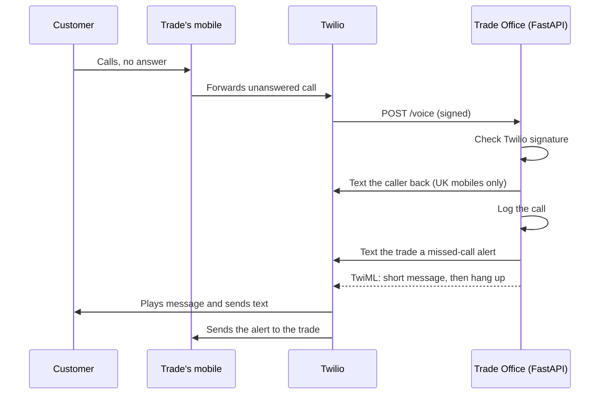

# Trade Office

An office assistant for UK tradespeople, sold as **Ask Jack** ([askjack.uk](https://askjack.uk)). When a plumber or electrician can't answer their phone, the caller gets a text from the business within seconds, so the job isn't lost to the next number on Google. Then "Jack" handles the admin on WhatsApp: jobs, quotes, bookings, invoices and payments, in the tradesperson's own words.

Built with Python, FastAPI, SQLModel and Twilio, with Claude for reading rough messages.

## What it does

- **Missed calls:** texts the caller back from the business, alerts the tradesperson, and forwards the customer's replies. Family and friends are never texted, and STOP is always respected.
- **Jobs and diary on WhatsApp:** log a job, book it in, see the week, then MOVE, CANCEL or mark it DONE. Plain messages work too: "send mrs jones her quote" is understood, and anything that texts a customer is checked first.
- **Quotes:** from a typed message, a voice note or a photo of notes, with the tradesperson's saved prices. Quotes are PDFs in the trade's own colours. The customer gets a private link to view and accept the quote.
- **Invoices and money:** turn a final quote into an invoice, see who owes what, mark payments, and text overdue customers a polite reminder.
- **Reviews:** one review request the day after a job, only if the customer ticked a box saying yes.
- **A morning briefing** with the day's jobs and what's owed, and short menus (Jobs, Money, More) instead of commands to remember.
- **UNDO** for the last change, from WhatsApp or the web.
- **My page:** a private web page logged into from WhatsApp. It shows today and the week with Call and Directions buttons, and a page for each customer with their jobs, quotes, invoices and notes. Tradespeople can open PDFs, correct a phone number or address, and tap Job done or Mark as paid.
- **Admin pages** for me to add and manage clients.
- **Their data, their way out:** a full Excel export at any time, and deleting a client removes every record they own.

## Status

Phase 1 (proof of concept) is complete and Phase 2 is built. The app is deployed on Render and runs 24/7, and it has been tested with real calls on a UK Twilio number, including real call forwarding from a mobile. It has 342 pytest tests, plus small evaluation scripts that check the AI against made-up messages. Next: a first trial with a real tradesperson.

One real-world finding: on iPhones, **Live Voicemail** answers missed calls on the phone itself, so the network never treats them as unanswered and the divert never happens. It has to be turned off during setup.

## How it works



1. The tradesperson sets their mobile to forward unanswered calls to a Twilio number.
2. Twilio sends the call details to the `/voice` webhook.
3. The app checks the request really came from Twilio (`X-Twilio-Signature`), then texts the caller back if they're on a UK mobile. Withheld numbers and landlines hear a message but aren't texted.
4. Every genuine call is logged with its time, caller and whether a text was sent.
5. The tradesperson gets an alert text for every missed call, e.g. "Missed call from 07… We've texted them back", or a prompt to ring back if the caller couldn't be texted.
6. Family and friends on a skip list never get the business text, but the tradesperson is still alerted that they called.
7. When a customer replies to the text-back, their message is forwarded to the tradesperson's mobile, so replies aren't lost.

## Endpoints

| Method | Path | Does |
| --- | --- | --- |
| GET | `/` | Health check |
| POST | `/voice` | Twilio webhook for incoming calls |
| POST | `/sms` | Twilio webhook for incoming texts: forwards customers' replies to the tradesperson |
| POST | `/whatsapp` | Twilio webhook for incoming WhatsApp messages: recognises tradespeople by their mobile number, and handles a menu, `LOG` to save a job, `OWED` and `PAID` for money owed, `BOOK` and `WEEK` for the diary, `EXPORT` for all their data, `ALERTS ON`, `ALERTS OFF`, `QUOTE` to save a draft quote and reply with its PDF, `CHANGE` to edit a draft in plain words, `FINAL` to finish one, `INVOICE` to make an invoice from it, and `PRICE` / `PRICES` to manage standard prices |
| GET | `/quotes/{id}.pdf` | Downloads a quote's PDF; only works with a signed link that expires after 7 days |
| GET | `/invoices/{id}.pdf` | Downloads an invoice's PDF, signed the same way |
| POST | `/whatsapp-status` | Twilio delivery updates: sends a WhatsApp alert by SMS instead if it fails |
| GET, POST | `/q/{id}` | The customer's quote page: view and accept a quote (signed link, 30 days) |
| GET, POST | `/login/{token}` | Logs a tradesperson in from a one-time WhatsApp link |
| GET | `/me`, `/customers`, `/customers/{id}`, `/money` | The tradesperson's own pages: Today, Customers, one customer, Money |
| POST | `/customers/{id}/notes`, `/customers/{id}/details` | Save a customer's notes, or correct their phone or address |
| POST | `/jobs/{number}/done`, `/invoices/{number}/paid`, `/undo` | The Job done, Mark as paid and Undo buttons |
| GET | `/my/quotes/{id}.pdf`, `/my/invoices/{id}.pdf` | PDFs for the logged-in tradesperson |
| GET | `/download` | All the tradesperson's data as a spreadsheet |
| GET, POST | `/admin/...` | My admin pages for clients, opened from a one-time link sent to my phone |

## Project layout

```
backend/
  main.py          # FastAPI app and endpoints
  whatsapp.py      # Jack's WhatsApp commands and replies
  alerts.py        # send texts safely and alert me when something fails
  web.py           # the tradesperson's own web pages and login
  admin.py         # my admin pages for managing clients
  templates/       # the HTML for those pages
  database.py      # SQLModel tables (clients, calls, customers, jobs, quotes, invoices) and lookups
  sms.py           # send_sms() using the Twilio client
  quotes.py        # read typed quotes, money and dates, signed download links
  pdfs.py          # make quote and invoice PDFs in the client's colours
  menu.py          # the WhatsApp menus (Jobs, Money, More) and help text
  diary.py         # bookings in UK time and the week ahead
  export.py        # a client's data as an Excel spreadsheet
  weekly.py        # the Sunday 6pm week-ahead update
  reviews.py       # one review request after a job, only with the customer's consent
  voice.py         # voice notes to text, with AssemblyAI's EU service
  ai.py            # read rough messages (quotes, jobs, bookings) with Claude
  eval_quotes.py   # check the AI against 27 made-up quote messages (costs about 25p)
  eval_bookings.py # check the AI's reading of dates and times (costs about 1p)
  eval_router.py   # check the AI turns plain messages into the right command (a few pence)
  ai_costs.py      # what the AI cost in the last 30 days, per client
  settings.py      # app-wide settings read from .env
  add_client.py    # add a real client by answering questions
  list_clients.py  # show every client
  update_client.py # change a client's details, or pause them
  set_business_details.py  # a client's legal name, address and bank details
  delete_client.py # delete a client who's leaving, and all their records
  add_skip_numbers.py  # add a client's family and friends (never texted)
  seed.py          # add two fake clients for local testing
  requirements.txt
  .env.example     # the settings the app needs (copy to .env)
```

## Run it locally

Needs Python 3.12+, a Twilio account and [ngrok](https://ngrok.com).

```bash
cd backend
python3 -m venv .venv
source .venv/bin/activate
pip install -r requirements.txt
cp .env.example .env    # then fill in your own values
uvicorn main:app --reload
```

Check it's running at http://127.0.0.1:8000, and run the tests with `pytest`. (The interactive `/docs` pages are switched off, because the app is public.)

To receive real calls, expose the app with ngrok and set your Twilio number's "A call comes in" webhook to `https://<your-ngrok-domain>/voice` (HTTP POST). Set `PUBLIC_URL` in `.env` to the same ngrok address, as the signature check depends on it.

## Security and privacy

- Secrets live in `.env`, which is never committed.
- `/voice` rejects any request without a valid Twilio signature, so the public URL can't be used to send texts.
- No public endpoint can send a text on demand: an earlier `/test-sms` endpoint was removed once the app went live, because anyone could have triggered texts at our cost. The API docs pages are switched off too.
- The call log contains callers' numbers, so it is gitignored. Customers are only ever texted about their own enquiry (UK GDPR).
- If a text fails, the caller still gets a clean message, the tradesperson is told to ring back, and I get an alert text plus a line in the logs. The logs never include a customer's number.
- WhatsApp alerts are opt-in. Each one is held until it's confirmed delivered, and goes by SMS if it fails or takes over 2 minutes, so a missed call isn't lost.
- Each number gets one text-back in 24 hours, and alerts to the tradesperson stop after three calls from that number, so repeated scam calls can't run up costs.
- The web pages only ever show the logged-in tradesperson's own data. Every page and button looks things up by that client, and tests try to reach another client's customers, PDFs, jobs and invoices to prove they can't. Customer names never go in web addresses.
- Logins come from one-time links that work for 15 minutes, and only a hash of each token is stored. Admin logins last 12 hours.
- Call records are deleted after 12 months by a background job (APScheduler) that runs nightly and at every start. Opt-outs are kept, so a STOP is never forgotten. The job also counts the old records Twilio still holds, as a dry run before it starts deleting those too.

## Roadmap

- **Now:** a first trial with a real tradesperson, then a 7-day reliability run
- **Next:** Postgres on deployment, and deleting old records at Twilio too
- **Later:** a React dashboard
