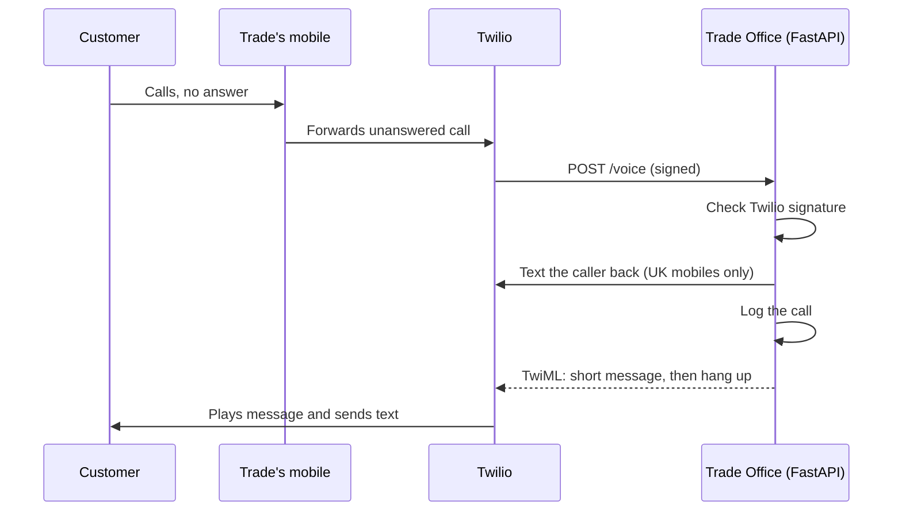

# Trade Office

Missed-call text-back for UK tradespeople. When a plumber or electrician can't answer their phone, the caller gets a text from the business within seconds, so the job isn't lost to the next number on Google.

Built with Python, FastAPI and Twilio. This is the first piece of a larger "AI office" for trades: job tracking, bookings, payment chasers and quotes, all handled by text.

## Status

Phase 1 (proof of concept). The missed-call webhook, signature check and call log are built and tested with signed test requests. A live call test is next, once the Twilio account is upgraded from the trial.

## How it works



1. The tradesperson sets their mobile to forward unanswered calls to a Twilio number.
2. Twilio sends the call details to the `/voice` webhook.
3. The app checks the request really came from Twilio (`X-Twilio-Signature`), then texts the caller back if they're on a UK mobile. Withheld numbers and landlines hear a message but aren't texted.
4. Every genuine call is logged with its time, caller and whether a text was sent.

## Endpoints

| Method | Path | Does |
| --- | --- | --- |
| GET | `/` | Health check |
| POST | `/test-sms` | Sends a test text to the owner's own mobile only |
| POST | `/voice` | Twilio webhook for incoming calls |

## Project layout

```
backend/
  main.py          # FastAPI app and endpoints
  sms.py           # send_sms() using the Twilio client
  call_log.py      # log_call() writes missed calls to calls.csv
  settings.py      # all settings and message wording in one place
  requirements.txt
  .env.example     # the settings the app needs (copy to .env)
```

## Run it locally

Needs Python 3.12+, a Twilio account and [ngrok](https://ngrok.com).

```bash
cd backend
python3 -m venv .venv
source .venv/bin/activate
pip install -r requirements.txt
cp .env.example .env    # then fill in your own values
uvicorn main:app --reload
```

Then open http://127.0.0.1:8000/docs.

To receive real calls, expose the app with ngrok and set your Twilio number's "A call comes in" webhook to `https://<your-ngrok-domain>/voice` (HTTP POST). Set `PUBLIC_URL` in `.env` to the same ngrok address, as the signature check depends on it.

## Security and privacy

- Secrets live in `.env`, which is never committed.
- `/voice` rejects any request without a valid Twilio signature, so the public URL can't be used to send texts.
- `/test-sms` can only text the owner's own number.
- The call log contains callers' numbers, so it is gitignored. Customers are only ever texted about their own enquiry (UK GDPR).

## Roadmap

- **Phase 2:** many clients from one app (SQLModel and Postgres), alerts to the trade, review requests, an AI assistant for jobs and payments by text, deployment to Railway or Render, pytest tests and a 7-day reliability run
- **Later:** quotes, invoices, a React dashboard
