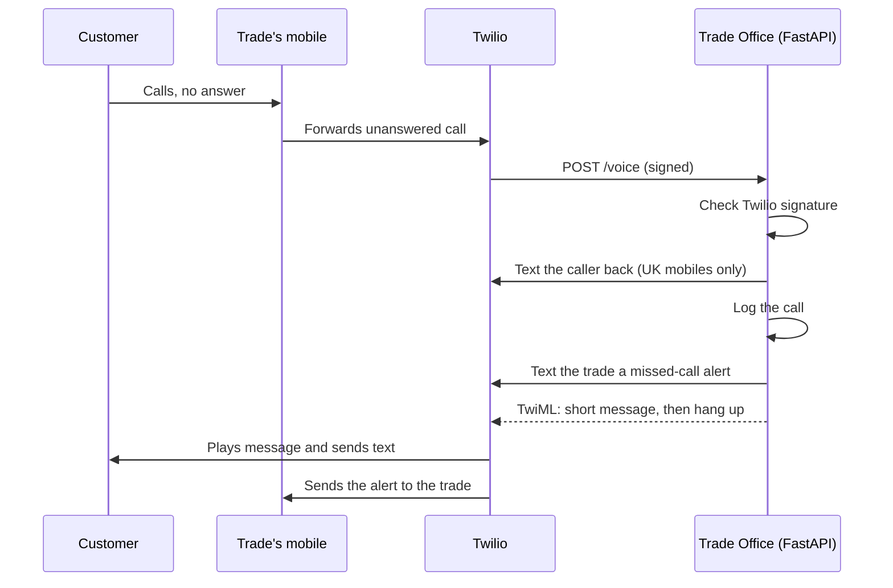

# Trade Office

Missed-call text-back for UK tradespeople. When a plumber or electrician can't answer their phone, the caller gets a text from the business within seconds, so the job isn't lost to the next number on Google.

Built with Python, FastAPI and Twilio. This is the first piece of a larger "AI office" for trades: job tracking, bookings, payment chasers and quotes, all handled by text.

## Status

Phase 1 (proof of concept) is complete. The missed-call webhook, signature check and call log are covered by pytest tests and have been tested with real calls on a UK Twilio number, including real call forwarding from a mobile. It's deployed on Render and runs 24/7. Since then it has gained a SQLite database so one app can serve many businesses, missed-call alerts to the tradesperson, forwarding of customers' replies, a per-client family-and-friends skip list, STOP and START handling, 12-month data cleanup and failure alerts. Next: a first trial with a real tradesperson.

One real-world finding: on iPhones, **Live Voicemail** answers missed calls on the phone itself, so the network never treats them as unanswered and the divert never happens. It has to be turned off during setup.

## How it works



1. The tradesperson sets their mobile to forward unanswered calls to a Twilio number.
2. Twilio sends the call details to the `/voice` webhook.
3. The app checks the request really came from Twilio (`X-Twilio-Signature`), then texts the caller back if they're on a UK mobile. Withheld numbers and landlines hear a message but aren't texted.
4. Every genuine call is logged with its time, caller and whether a text was sent.
5. The tradesperson gets an alert text for every missed call, e.g. "Missed call from 07… We've texted them back", or a prompt to ring back if the caller couldn't be texted.
6. Family and friends on a skip list never get the business text, but the tradesperson is still alerted that they called.
7. When a customer replies to the text-back, their message is forwarded to the tradesperson's mobile, so replies aren't lost.

## Endpoints

| Method | Path | Does |
| --- | --- | --- |
| GET | `/` | Health check |
| POST | `/voice` | Twilio webhook for incoming calls |
| POST | `/sms` | Twilio webhook for incoming texts: forwards customers' replies to the tradesperson |
| POST | `/whatsapp` | Twilio webhook for incoming WhatsApp messages: recognises tradespeople by their mobile number, and handles a menu, `LOG` to save a job, `OWED` and `PAID` for money owed, `BOOK` and `WEEK` for the diary, `EXPORT` for all their data, `ALERTS ON`, `ALERTS OFF`, `QUOTE` to save a draft quote and reply with its PDF, `CHANGE` to edit a draft in plain words, `FINAL` to finish one, `INVOICE` to make an invoice from it, and `PRICE` / `PRICES` to manage standard prices |
| GET | `/quotes/{id}.pdf` | Downloads a quote's PDF; only works with a signed link that expires after 7 days |
| GET | `/invoices/{id}.pdf` | Downloads an invoice's PDF, signed the same way |
| POST | `/whatsapp-status` | Twilio delivery updates: sends a WhatsApp alert by SMS instead if it fails |

## Project layout

```
backend/
  main.py          # FastAPI app and endpoints
  whatsapp.py      # Jack's WhatsApp commands and replies
  alerts.py        # send texts safely and alert me when something fails
  database.py      # SQLModel tables (clients, calls, jobs, quotes, invoices) and lookups
  sms.py           # send_sms() using the Twilio client
  quotes.py        # read typed quotes, money and dates, signed download links
  pdfs.py          # make quote and invoice PDFs in the client's colours
  menu.py          # the WhatsApp Options menu and help text
  diary.py         # bookings in UK time and the week ahead
  export.py        # a client's data as an Excel spreadsheet
  ai.py            # read rough messages (quotes, jobs, bookings) with Claude
  eval_quotes.py   # check the AI against 27 made-up quote messages (costs about 25p)
  eval_bookings.py # check the AI's reading of dates and times (costs about 1p)
  ai_costs.py      # what the AI cost in the last 30 days, per client
  settings.py      # app-wide settings read from .env
  add_client.py    # add a real client by answering questions
  list_clients.py  # show every client
  update_client.py # change a client's details, or pause them
  set_business_details.py  # a client's legal name, address and bank details
  add_skip_numbers.py  # add a client's family and friends (never texted)
  seed.py          # add two fake clients for local testing
  requirements.txt
  .env.example     # the settings the app needs (copy to .env)
```

## Run it locally

Needs Python 3.12+, a Twilio account and [ngrok](https://ngrok.com).

```bash
cd backend
python3 -m venv .venv
source .venv/bin/activate
pip install -r requirements.txt
cp .env.example .env    # then fill in your own values
uvicorn main:app --reload
```

Check it's running at http://127.0.0.1:8000, and run the tests with `pytest`. (The interactive `/docs` pages are switched off, because the app is public.)

To receive real calls, expose the app with ngrok and set your Twilio number's "A call comes in" webhook to `https://<your-ngrok-domain>/voice` (HTTP POST). Set `PUBLIC_URL` in `.env` to the same ngrok address, as the signature check depends on it.

## Security and privacy

- Secrets live in `.env`, which is never committed.
- `/voice` rejects any request without a valid Twilio signature, so the public URL can't be used to send texts.
- No public endpoint can send a text on demand: an earlier `/test-sms` endpoint was removed once the app went live, because anyone could have triggered texts at our cost. The API docs pages are switched off too.
- The call log contains callers' numbers, so it is gitignored. Customers are only ever texted about their own enquiry (UK GDPR).
- If a text fails, the caller still gets a clean message, the tradesperson is told to ring back, and I get an alert text plus a line in the logs. The logs never include a customer's number.
- WhatsApp alerts are opt-in. Each one is held until it's confirmed delivered, and goes by SMS if it fails or takes over 2 minutes, so a missed call isn't lost.
- Each number gets one text-back in 24 hours, and alerts to the tradesperson stop after three calls from that number, so repeated scam calls can't run up costs.
- Call records are deleted after 12 months by a background job (APScheduler) that runs nightly and at every start. Opt-outs are kept, so a STOP is never forgotten. The job also counts the old records Twilio still holds, as a dry run before it starts deleting those too.

## Roadmap

- **Phase 2:** many clients from one app (SQLModel and Postgres), alerts to the trade, review requests, an AI assistant for jobs and payments by text, deployment to Railway or Render, pytest tests and a 7-day reliability run
- **Later:** quotes, invoices, a React dashboard
